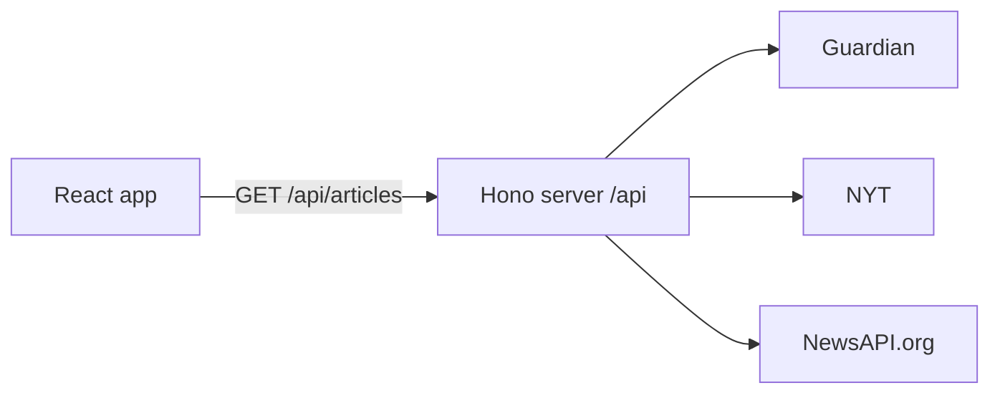
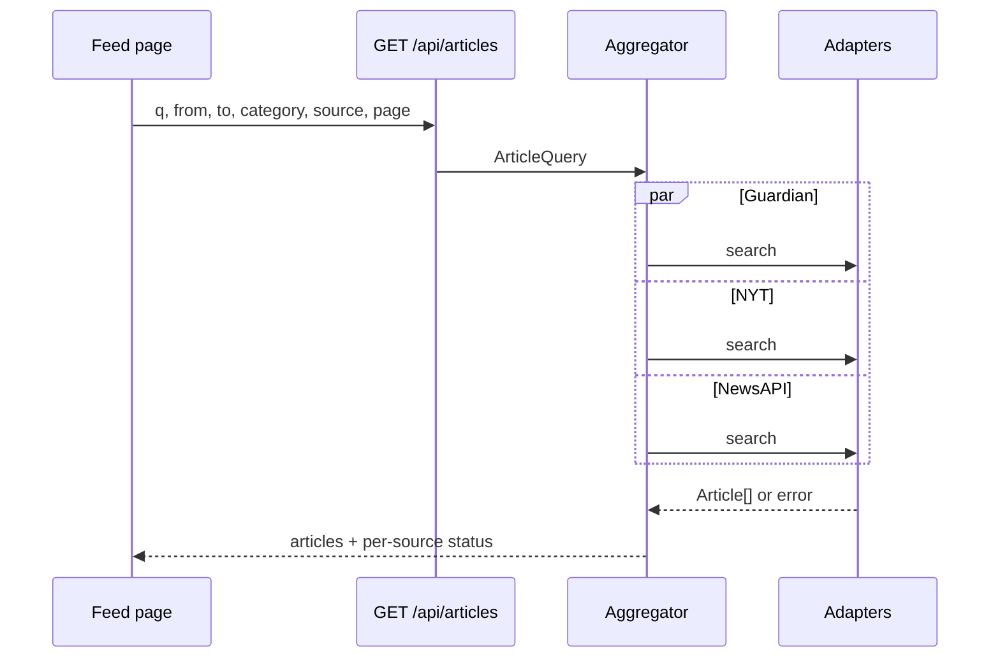

# Architecture

Folio is one repository and one deployable process. The React app is a static build. A small Hono server reads the news APIs, maps them to a single article shape, and also serves that static build in production.



The browser talks only to Folio. API keys stay in the server environment.

## Why this shape

| Decision | Choice | Reason |
| --- | --- | --- |
| App shell | Vite SPA, React Router | The brief asks for a React interface, not a server-rendered site. Two routes are enough. |
| UI kit | Chakra UI 3 | Requested. Tokens and recipes cover theming, responsive props, and accessible form controls. |
| Structure | Atomic Design folders | Requested. Boundaries are enforced by a rule: only pages fetch. |
| Keys and CORS | Hono BFF in-process | NewsAPI.org blocks browser calls on the free tier. The Guardian and NYT keys must not ship in the JS bundle. One Node process keeps Docker to a single container. |
| Preferences | `localStorage` | The brief asks for a personalized feed, not accounts. |
| Missing keys | `DATA_MODE=fixture` | A reviewer can run the UI before signing up for three APIs. |
| Shared code | `shared/` imported by `src/` and `server/` | One `Article` type and one category map. No second copy, no monorepo tooling. |

Next.js was not chosen. The UI does not need server rendering, and a dedicated BFF makes the adapter boundary obvious for the SOLID requirement.

## Processes and ports

| Mode | What runs | Port |
| --- | --- | --- |
| Local UI | Vite | 4173 |
| Local API | `tsx server/index.ts` | 4181 |
| Docker / production | Node serves `dist/` and the API | 4180 |

Vite proxies `/api` to `http://127.0.0.1:4181` during development. The UI always calls relative `/api/...` URLs, so the same client build works in dev and in Docker.

Ports 3000, 5173, and 8080 are avoided on purpose.

## Request flow

1. The feed page reads the URL and `localStorage`, then merges them into an `ArticleQuery` (rules in [UI behavior](05-ui.md)).
2. The page calls `GET /api/articles` with that query.
3. The server picks adapters for the requested sources. In fixture mode it skips the network and reads `server/fixtures/`.
4. Adapters run in parallel with `Promise.allSettled`. A rejected adapter becomes a source error. It does not reject the whole response.
5. Each adapter maps its payload to `Article[]` using the shared category map.
6. The aggregator dedupes, drops articles that fail the author or category safety filter, sorts by `publishedAt` descending, and returns the page.



## HTTP contract

### `GET /api/articles`

Query parameters:

| Param | Format | Notes |
| --- | --- | --- |
| `q` | string | Optional. Empty means latest. |
| `from` | `YYYY-MM-DD` | Optional, inclusive. |
| `to` | `YYYY-MM-DD` | Optional, inclusive. |
| `category` | repeated or comma-separated id | Optional. Omitted means all categories. |
| `source` | repeated or comma-separated id | Optional. Omitted means every configured source. |
| `author` | repeated | Optional. Applied after fetch. |
| `page` | integer, default 1 | 1-based. |

Response `200`:

```json
{
  "articles": [],
  "page": 1,
  "pageSize": 10,
  "sources": [
    { "id": "guardian", "status": "ok", "count": 10 },
    { "id": "nyt", "status": "error", "message": "NYT rate limit reached" },
    { "id": "newsapi", "status": "ok", "count": 8 }
  ],
  "mode": "live"
}
```

`pageSize` is **per source**. A full page can contain up to 30 articles (10 × 3) before dedupe.

Status codes:

| Code | When |
| --- | --- |
| 200 | At least the call was understood. Individual sources may still be `error`. |
| 400 | Bad date, unknown source id, or `page` less than 1. Body: `{ "error": "..." }`. |
| 500 | Unexpected server failure. The UI treats this like a full-feed error with a retry. |

### `GET /api/sources`

Returns the catalog the filters render: `id`, `name`, and which of the shared categories that source can serve. The UI does not hardcode outlet names.

### `GET /api/health`

Returns `{ "ok": true, "mode": "fixture" | "live" }`. Docker and the UI use this to decide whether to show the sample-data banner.

## Folder layout

```
shared/
  article.ts          Article, ArticleQuery, ArticlePage
  sources.ts          SourceId, catalog
  categories.ts       CategoryId, labels, per-source maps
  preferences.ts      Preferences type, default, parse/serialize

server/
  index.ts            Hono app, static files in production
  routes/articles.ts  Validates query, calls aggregator
  sources/
    types.ts          NewsSource interface
    guardian.ts
    nyt.ts
    newsapi.ts
    fixture.ts        Same interface, reads JSON
    index.ts          Registry: id -> adapter
  aggregate.ts        Parallel fetch, dedupe, sort, author filter
  fixtures/           One JSON file per source, checked in
  env.ts              Reads DATA_MODE and the three keys

src/
  main.tsx
  app.tsx             Router and providers
  theme/              Chakra system
  api/client.ts       fetch wrapper for /api/articles and /api/sources
  hooks/
    useArticleQuery.ts
    usePreferences.ts
  pages/
    FeedPage.tsx
  components/
    atoms/
    molecules/
    organisms/
    templates/
```

`shared/` is compiled as part of both the Vite app and the server. Path alias `@shared/*` points at it from both `tsconfig` files. Do not publish it as a package.

## Domain types

```ts
type SourceId = "guardian" | "nyt" | "newsapi";

type CategoryId =
  | "world"
  | "politics"
  | "business"
  | "technology"
  | "science"
  | "health"
  | "sports"
  | "culture"
  | "opinion";

type Article = {
  id: string;            // `${source}:${nativeId}`
  title: string;
  summary: string;
  url: string;
  imageUrl?: string;
  publishedAt: string;   // ISO-8601
  source: SourceId;
  sourceName: string;
  author?: string;
  category?: CategoryId;
};

type ArticleQuery = {
  q?: string;
  from?: string;
  to?: string;
  categories: CategoryId[];
  sources: SourceId[];
  authors: string[];
  page: number;
};
```

`id` is always namespaced by source so dedupe and React keys never collide across outlets.

## Aggregation rules

- **Fan-out.** Only adapters whose id is in `query.sources` are called.
- **Isolation.** One adapter throwing, timing out (8 seconds), or returning a non-2xx becomes `{ status: "error" }` for that source.
- **Dedupe.** Key is the article URL with scheme, trailing slash, and `www.` removed. If the URL is missing, the key is the lowercased title plus the calendar date. The earlier-published copy wins; on a tie, prefer Guardian, then NYT, then NewsAPI.
- **Author filter.** Keep the article when `authors` is empty, or when `author` contains any requested name (case-insensitive). Articles with no byline are excluded once an author filter is active.
- **Category safety net.** Adapters should pass the right section to the upstream API. The aggregator still drops articles whose mapped category is outside `query.categories`, when that list is non-empty. Articles with no mapped category are kept only when the reader did not pick a category.
- **Sort.** `publishedAt` descending. Missing dates sort last.
- **Page.** Each adapter is asked for `page` and a size of 10. The aggregator does not re-slice the merged list down to 10. "Load more" increments `page` and the client appends.

## Preferences and URL

Two stores, two jobs:

| Store | Owns | Written by |
| --- | --- | --- |
| `localStorage` `folio.preferences.v1` | The saved feed | Save and Reset only |
| URL search params | The feed on screen | Every filter change |

Merge, in order:

1. Start from saved preferences (or the default if none / if JSON is invalid).
2. If the URL contains `q`, `from`, `to`, `category`, `source`, or `author`, that param replaces the preference value. An empty param means "cleared," not "fall back."
3. `page` always comes from the URL, default 1.

Opening `/` with an empty query string shows the saved feed. Opening a shared URL shows exactly that URL, without overwriting what is saved.

## Failure and empty behavior

| Situation | Server | UI |
| --- | --- | --- |
| All adapters ok, zero articles | 200, empty `articles` | Empty state naming the active filters |
| Some adapters error | 200, mixed `sources` | Feed of the successful articles, plus a banner listing failed source names |
| All adapters error | 200, empty articles, all sources `error` | Full error state and a retry button |
| Invalid query | 400 | Inline message, no crash |
| Fixture mode | 200, `mode: "fixture"` | Info banner: sample articles, not live news |

## Configuration

| Variable | Required | Default |
| --- | --- | --- |
| `DATA_MODE` | no | Ignored when any API key is set (`live`). With no keys, `fixture` unless this is explicitly `live`. |
| `GUARDIAN_API_KEY` | only when live | empty |
| `NYT_API_KEY` | only when live | empty |
| `NEWSAPI_API_KEY` | only when live | empty |
| `PORT` | no | `4180` in the image, `4181` in local dev |

If `DATA_MODE=live` and a key is missing, that one source returns a clear error (`Guardian API key is not set`) and the others still run. The server does not invent articles in live mode.
