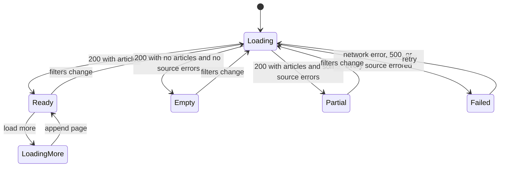

# Atomic Design

Folio's UI is split into five levels. Chakra UI supplies the primitives (buttons, inputs, dialogs, layout). Folio's components are the product-specific layer on top. Do not wrap every Chakra component "just to have an atom." Add a Folio component only when the product has a repeated visual or a named concept.

## The rule that keeps the levels honest

| Level | May contain | May not contain |
| --- | --- | --- |
| Atom | One visual element. Chakra primitives, theme tokens. | Another Folio component. Data fetching. `localStorage`. Router hooks. |
| Molecule | Two or more atoms, arranged for one small job. | Fetching. Knowledge of which page it sits on. |
| Organism | A section of a page. Domain props such as `Article`. | `fetch`, React Query calls, reading preferences. |
| Template | Layout slots: header, sidebar, main. | Copy that belongs to a single page. Sample article data. |
| Page | Routing, the article client, preference hook, loading/error branching. | Large chunks of JSX that belong in an organism. Extract them. |

Pages compose templates. Templates compose organisms. Organisms compose molecules and atoms. A level may use Chakra layout primitives (`Box`, `Stack`, `Grid`, `Flex`) directly. That is not a layering violation.

If a visual is used once and has no name of its own, leave it inline in the organism. KISS beats a perfect pyramid of one-off files.

## Chakra setup

Use Chakra UI 3 with the official Vite provider snippet.

- Packages: `@chakra-ui/react`, `@emotion/react`.
- One system in `src/theme/system.ts`, created with `createSystem` / `defineConfig`.
- `src/main.tsx` wraps the tree in `ChakraProvider`.
- Add only the snippets the steps name: `provider`, `color-mode`, `field`, `empty-state` (or a small in-house empty state if that snippet is not in the installed CLI). Card layout is an organism, not a Chakra card pasted raw into the page.

Theme tokens live in the system, not in component files. Components use token names (`bg="paper"`, `color="ink"`). See [UI behavior](05-ui.md) for the token list.

## Atoms

Path: `src/components/atoms/`. One file per component, named export matching the filename.

| Component | Chakra base | Responsibility |
| --- | --- | --- |
| `SourceBadge` | `Badge` | Renders a source id as its display name and a stable color. `guardian` ink, `nyt` the accent, `newsapi` a muted blue. |
| `CategoryBadge` | `Badge` | Category label, neutral color, `variant="outline"`. Renders nothing when category is missing. |
| `TimeAgo` | `Text` | Formats an ISO date as a relative time ("2h ago") and sets `<time dateTime>`. Falls back to the calendar date after 7 days. |
| `ExternalLink` | `Link` | `target="_blank"` and `rel="noopener noreferrer"`. Includes visually hidden text ", opens in a new tab". |
| `IconButton` | `IconButton` | Thin wrapper that requires `aria-label`, so callers cannot ship an unlabeled icon. |
| `SearchField` | `Field` + `Input` | Labeled search input. Props: `value`, `onChange`, `onSubmit`. Submits on Enter. No debounce here; the page debounces. |

`Button`, `Spinner`, `Skeleton`, and `Heading` are used as Chakra primitives directly. Wrapping them adds nothing.

## Molecules

Path: `src/components/molecules/`.

| Component | Built from | Props | Job |
| --- | --- | --- | --- |
| `ArticleMeta` | `SourceBadge`, `CategoryBadge`, `TimeAgo` | `source`, `category`, `publishedAt` | One line of metadata under a headline. |
| `AuthorLine` | `Text` | `author?: string` | "By {name}", or nothing when the byline is absent. |
| `FilterChip` | Chakra `Button` or `Tags` | `label`, `onRemove` | A removable summary of one active filter ("Technology", "Last 7 days"). |
| `AuthorTagInput` | `Input`, `FilterChip` | `authors`, `onChange` | Type a name, Enter adds it, chip removes it. Used for preferred authors. |
| `SourceStatus` | `Text` | `name`, `status`, `message?` | One line in the partial-failure banner. |
| `ResultCount` | `Text` | `count`, `mode` | "18 stories" plus "Sample data" when `mode` is `fixture`. |

## Organisms

Path: `src/components/organisms/`.

### `ArticleCard`

The unit of the feed.

- Props: `article: Article`.
- Layout: thumbnail on top (hidden if `imageUrl` is missing — no broken-image icon), then `ArticleMeta`, title as `Heading` size `md`, two-line summary, `AuthorLine`, `ExternalLink` "Read story".
- The whole title is the link as well as the footer link. Use one `ExternalLink` around the title and a second text link; both share the same `href`.
- Image `alt` is `""` because the title already names the story. The image is decorative.

### `ArticleList`

- Props: `articles: Article[]`.
- Renders a `Grid` of `ArticleCard`s. Responsive columns are set here: 1 / 1 / 2 / 3 at base / md / lg / xl.
- Owns nothing about loading. The page decides whether to render the list, the skeleton, or the empty state.

### `FeedToolbar`

- Props: `query`, `onQueryChange`, `onOpenFilters` (used below the `lg` breakpoint), `onOpenPreferences`.
- Contains the wordmark, `SearchField`, a Filters button visible only below `lg`, a preferences button, and the color-mode button.
- The wordmark is a React Router `Link` to `/`.

### `FilterPanel`

- Props: `query`, `sources` (catalog), `onChange`.
- Sections: date presets and two date inputs, category checkboxes, source checkboxes.
- Used in the desktop sidebar and inside the mobile drawer. Same component, two parents. This is the DRY point for filters.

### `ActiveFilters`

- Props: `query`, `onClear` per key or `onChange`.
- Renders `FilterChip`s for every constraint that is not the default. Hidden when nothing is narrowed.

### `SourceHealth`

- Props: `sources` from the API response.
- Renders nothing when every source is `ok`.
- Otherwise a banner listing each failed source via `SourceStatus`, with the server message.

### `PreferencesForm`

- Props: `value: Preferences`, `sources`, `onChange`, `onSave`, `onReset`, `saving`.
- Source toggles, category checkboxes, `AuthorTagInput`.
- Save and Reset are explicit buttons. Toggling a checkbox does not write `localStorage` by itself; the page saves on submit. That keeps "editing" and "saved feed" from getting tangled.

### `FeedSkeleton`

- Six Chakra `Skeleton` blocks in the same grid as `ArticleList`.
- Rendered only for the first page. Loading the next page shows a spinner under the existing cards instead of replacing them.

### `EmptyFeed`

- Props: `onResetFilters`.
- Heading "Nothing matches this feed", one sentence naming that filters or authors may be too narrow, and a button to clear filters.

## Templates

Path: `src/components/templates/`.

### `AppShell`

Slots:

- `toolbar` — always visible, sticky.
- `sidebar` — rendered only from the `lg` breakpoint up.
- `main` — the page body.
- `banner` — optional, full width under the toolbar (fixture mode, source errors).

Sets the page background to `paper`, color to `ink`, and the content max width to `1120px` with horizontal padding `4` on mobile and `8` from `md` up.

There is no second template. Preferences open in a Chakra `Drawer` owned by `FeedPage`, not on their own route. One route keeps the feed in view while preferences are edited.

## Pages

Path: `src/pages/`.

### `FeedPage`

The only page. It is allowed to:

- Call `usePreferences`.
- Call `useArticleQuery` (URL read/write).
- Call the API client.
- Hold loading, error, and "loading more" flags.
- Compose `AppShell`, `FeedToolbar`, `FilterPanel`, `ArticleList`, `EmptyFeed`, `FeedSkeleton`, `SourceHealth`, `PreferencesForm`.

State machine the page must cover:

`Load more` is shown when the last response had at least one source with `count` equal to `pageSize`. It is hidden on empty and failed states.

## File naming

- Component files are `PascalCase.tsx`.
- One component per file.
- Props type is `{Name}Props` in the same file, not exported unless a test or parent needs it.
- No `index.ts` barrels. Import from the file path. Barrels hide cycles between organisms and molecules.

## What a violation looks like

- `ArticleCard` calling `/api/articles` — move the call to `FeedPage`.
- `FilterPanel` reading `localStorage` — the page passes `query` in.
- A `Button` atom that is only `<Button {...props} />` — delete it and use Chakra.
- The page file growing past a screen of JSX — extract an organism, keep the data hooks in the page.
