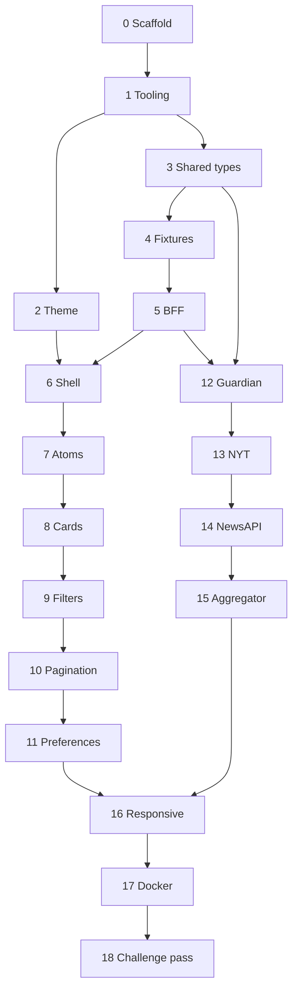

# Implementation steps

Build in this order. Each step ends with something you can run or test. Do not start a step until the previous step's exit check passes.

The commands assume the repo root. Package manager is npm.

## Step 0 — Scaffold the client

**Goal.** A Vite + React + TypeScript app that renders one heading.

**Work.**

1. Create the app with the official scaffold into a temporary directory, then move the files to the repo root. Do not point `create-vite` at `/workspace` directly.
2. Template: React + TypeScript.
3. Remove the scaffold counter demo. `App` renders the word Folio and nothing else.
4. Set `"strict": true` in `tsconfig` (the Vite React template already does).

**Exit check.** `npm run dev -- --host 127.0.0.1 --port 4173` shows "Folio" at `http://127.0.0.1:4173`.

## Step 1 — Dependencies and scripts

**Goal.** Chakra, the router, the server, and tests are installed. Scripts have their final names.

**Work.**

Install:

- `@chakra-ui/react` `@emotion/react`
- `react-router-dom`
- `hono` `@hono/node-server`
- `tsx` as a dev dependency, for running the server in dev
- `vitest` as a dev dependency
- `@fontsource/newsreader` `@fontsource/source-sans-3`

Add scripts to `package.json`:

| Script | Command |
| --- | --- |
| `dev` | Run the API and Vite together. Use `npm-run-all` or a tiny `scripts/dev.mjs` that spawns both. Do not add a heavier process manager. |
| `dev:web` | `vite --host 127.0.0.1 --port 4173` |
| `dev:api` | `tsx watch server/index.ts` |
| `build` | `tsc -b && vite build && tsc -p tsconfig.server.json` |
| `start` | `node dist-server/index.js` |
| `test` | `vitest run` |

Vite dev server proxies `/api` to `http://127.0.0.1:4181`.

Add `tsconfig.server.json` that emits `server/` and `shared/` to `dist-server/`.

Add path alias `@shared` in both tsconfigs and in `vite.config.ts`.

**Exit check.** `npm run dev` starts both processes. `GET http://127.0.0.1:4181/api/health` can 404 for now. Vite still serves the heading.

## Step 2 — Theme and provider

**Goal.** Chakra wraps the app and the paper/ink tokens exist.

**Work.**

1. Add the Chakra provider snippet and the color-mode snippet.
2. Create `src/theme/system.ts` with the tokens from [UI behavior](05-ui.md).
3. Import the two font packages in `src/main.tsx`.
4. Set `document` background to `paper` via the Chakra global css in the system, so the area outside the shell matches.

**Exit check.** The word Folio renders in Newsreader on the paper background. The color-mode button (temporary, in the corner) flips to the dark tokens.

## Step 3 — Shared types and the source catalog

**Goal.** Client and server import the same domain types.

**Work.**

Create the files listed under `shared/` in [Architecture](02-architecture.md):

- `article.ts` — `Article`, `ArticleQuery`, `ArticlePage`, `SourceStatus`.
- `sources.ts` — `SourceId`, catalog entries (`id`, `name`).
- `categories.ts` — `CategoryId`, labels, Guardian section map, NYT news-desk map, NewsAPI category map, and a `mapGuardianSection` helper.
- `preferences.ts` — `Preferences`, `defaultPreferences`, `parsePreferences` (returns the default on any bad input), `serializePreferences`.

No React imports in `shared/`.

**Exit check.** `npm run build` (or `tsc`) typechecks a throwaway import from both `src/app.tsx` and `server/index.ts`. Delete the throwaway imports after.

## Step 4 — Fixture data and fixture tests

**Goal.** Sample articles exist, and the filter logic that fixture mode needs is already tested.

**Work.**

1. Write `server/fixtures/guardian.json`, `nyt.json`, and `newsapi.json`. Twelve articles each, valid against `Article`. Use real public URLs and short original summaries. Spread `publishedAt` across the last 30 days and cover at least five categories.
2. Write `server/fixtures/filter.ts` with a pure function `filterArticles(articles, query)`.
3. Test it in `server/fixtures/filter.test.ts`: keyword, date window, category, page size, and the "[Removed]" case is not needed here (that is the NewsAPI mapper).

**Exit check.** `npm test` passes. Fixtures parse as JSON.

## Step 5 — BFF skeleton

**Goal.** The HTTP contract exists, served from fixtures.

**Work.**

1. `server/env.ts` reads `DATA_MODE` (default `fixture`), the three keys, and `PORT` (default `4181` when `NODE_ENV` is not `production`, else `4180`).
2. `server/index.ts` creates a Hono app, mounts routes, listens on `PORT`.
3. `GET /api/health` returns `{ ok: true, mode }`.
4. `GET /api/sources` returns the catalog plus the categories each source supports.
5. `GET /api/articles` parses the query (400 on a bad date, unknown source, or `page < 1`) and, for this step only, runs the fixture filter across the selected sources. Wrap the response in `ArticlePage` with `mode`.
6. Add `server/query.ts` to parse the URL into `ArticleQuery`. Unit-test the parser: missing params, repeated `category`, comma-separated `source`, and a bad date.

**Exit check.** With the server running, `curl 'http://127.0.0.1:4181/api/articles?q=climate&source=guardian'` returns fixture articles and `mode: "fixture"`. A request with `source=bbc` returns 400.

## Step 6 — App shell, routing, and the API client

**Goal.** The browser shows fixture articles. No filters yet.

**Work.**

1. `src/api/client.ts` fetches `/api/articles` and `/api/sources`. Throw a typed `ApiError` on non-2xx and on network failure. Pass an `AbortSignal`.
2. `src/components/templates/AppShell.tsx` with the slots from [Atomic Design](03-atomic-design.md).
3. `src/pages/FeedPage.tsx` loads page 1 on mount and renders titles in a plain stack. This is temporary markup; step 13 replaces it.
4. Route `/` to `FeedPage` with React Router.
5. Show the fixture banner when `mode` is `fixture`, and the failed state when the request throws.

**Exit check.** Opening `http://127.0.0.1:4173` lists fixture titles. Stopping the API shows "The feed did not load" and Try again.

## Step 7 — Atoms and molecules

**Goal.** The small pieces from [Atomic Design](03-atomic-design.md) exist and render in isolation.

**Work.**

Build, in this order: `SourceBadge`, `CategoryBadge`, `TimeAgo`, `ExternalLink`, `IconButton`, `SearchField`, then `ArticleMeta`, `AuthorLine`, `FilterChip`, `AuthorTagInput`, `SourceStatus`, `ResultCount`.

`TimeAgo` uses `Intl.RelativeTimeFormat('en')`. No date library.

**Exit check.** Each file compiles. A short temporary block on `FeedPage` renders one of each with fixture data, then that block is removed before the step is committed. `npm test` still passes.

## Step 8 — Article card, list, and skeleton

**Goal.** The feed looks like the product, still on fixtures, still without filters.

**Work.**

1. `ArticleCard`, `ArticleList`, `FeedSkeleton`, `EmptyFeed`, `SourceHealth` as specified.
2. `FeedPage` uses the state machine: loading, ready, empty, partial, failed.
3. Force an empty check by querying a keyword that matches nothing (`q=zzzz-no-match`) via a temporary hardcoded query, confirm `EmptyFeed`, then remove the hardcode.

**Exit check.** The home page shows a card grid of fixture articles, with image, badges, relative time, and a working outbound link. The first load shows skeletons.

## Step 9 — Filters in the URL

**Goal.** Search and filters change the query string and the results.

**Work.**

1. `src/hooks/useArticleQuery.ts` reads and writes the URL search params. Debounce keyword input by 300ms inside the hook or in `FeedToolbar`. Reset `page` when any other param changes.
2. `FilterPanel` and `ActiveFilters`.
3. `FeedToolbar` with the real search field.
4. On `lg` and up, `AppShell` shows `FilterPanel` in the sidebar. Below `lg`, a drawer holds it. Build the drawer now even if the spacing pass is step 16.
5. `FeedPage` refetches when the parsed query changes and aborts the previous request.

**Exit check.**

- Typing a keyword updates `?q=` and narrows the cards.
- A category and a source together narrow further.
- Reload keeps the filters.
- `?source=bbc` shows the failed state (the API returns 400), not a blank page.

## Step 10 — Pagination

**Goal.** Load more appends the next fixture page.

**Work.**

1. Keep loaded articles and the latest `ArticlePage` in the page.
2. "Load more" requests `page + 1` and appends articles whose `id` is new.
3. A filter change drops the accumulated list and loads page 1.

**Exit check.** With no keyword, the first paint shows 10 per selected source (up to 30). Load more adds the remaining fixture articles and then the button hides or a further click returns an empty addition without duplicating cards.

## Step 11 — Preferences

**Goal.** The saved feed survives a new visit.

**Work.**

1. `src/hooks/usePreferences.ts` reads `folio.preferences.v1`, uses `parsePreferences`, and writes through `serializePreferences`.
2. `PreferencesForm` inside a drawer, opened from "My feed".
3. Merge rules from [Architecture](02-architecture.md): URL wins when the param is present; otherwise preferences are the query.
4. Save writes storage and closes the drawer. Reset writes the default.
5. Draft state is local to the drawer. Dismissing it drops the draft.

**Exit check.**

- Save "technology" plus one author, then open a fresh tab on `/`. The feed is already narrowed, and the URL stays clean.
- Paste a `?category=sports` URL afterwards. The grid shows sports for that tab, and reopening `/` in a new tab still shows the saved technology feed.
- Corrupt the localStorage value. The page loads the default and does not throw.

## Step 12 — Guardian adapter

**Goal.** Live mode returns real Guardian articles. The other sources stay on fixtures until their steps.

**Work.**

1. `server/sources/types.ts` with `NewsSource` and `SourceError`.
2. `server/sources/guardian.ts` per the translation table in [Data sources](04-data-sources.md). Strip HTML from `trailText` with a small function, not a sanitizer library.
3. `server/sources/fixture.ts` implements the same interface using step 4.
4. Registry maps each source id to an adapter. Wire `GET /api/articles` through the registry in this step, and delete the inline fixture filtering from the route. In live mode, a source that does not have its live adapter yet (NYT and NewsAPI until their steps) still uses the fixture adapter. Guardian uses the live adapter.
5. Record one sanitized Guardian JSON payload under `server/sources/__fixtures__/guardian.json` (no API key in the file) and unit-test the mapper.

**Exit check.** Mapper tests pass offline. With `DATA_MODE=live` and `GUARDIAN_API_KEY` set, `source=guardian` returns real articles. Without the key, that source's status is `error` and the message is "Guardian API key is not set".

## Step 13 — New York Times adapter

**Goal.** NYT articles join the same feed.

**Work.**

1. `server/sources/nyt.ts` including the 0-based page index, `news_desk` filter, image URL prefixing, and byline cleanup.
2. In-memory 60-second cache around the fetch, keyed by the upstream URL. A cache hit does not count as a second upstream call.
3. Mapper test from a sanitized fixture file.

**Exit check.** Mapper tests pass. In live mode, `source=nyt` returns articles. A second identical request inside a minute does not change the cached title set. A 429 surfaces as "New York Times rate limit reached".

## Step 14 — NewsAPI adapter

**Goal.** All three sources answer in live mode.

**Work.**

1. `server/sources/newsapi.ts` with the top-headlines vs everything rule.
2. Drop items whose title is `"[Removed]"`.
3. Send the key in `X-Api-Key`, never in the query string, so it cannot leak into logs as easily.
4. Mapper test, including a removed article and a missing description.

**Exit check.** `GET /api/articles` with no `source` param fan-out to all three. `source.name` from NewsAPI shows on the card. `Article.source` remains `newsapi`.

## Step 15 — Aggregator

**Goal.** Partial failure, dedupe, author filter, and the category safety net match the architecture doc.

**Work.**

1. Move merge logic out of the route into `server/aggregate.ts`.
2. `Promise.allSettled`, 8-second `AbortSignal.timeout` per adapter.
3. Dedupe and sort as specified.
4. Unit tests with fake adapters: one rejecting, duplicate URLs across sources, author filter excluding a missing byline, category safety net, sort order.

The route becomes: parse query, call `aggregate`, return JSON.

**Exit check.** `npm test` covers the cases above. Pulling the network cable on a single adapter (or pointing it at an invalid host in a test) still returns the other articles with that source marked `error`.

## Step 16 — Responsive pass

**Goal.** The layout rules in [UI behavior](05-ui.md) hold.

**Work.**

1. Apply the breakpoint table to `AppShell`, `FeedToolbar`, and `ArticleList`.
2. Confirm the Filters button is the only way into `FilterPanel` below `lg`, and that it is gone from `lg` up.
3. Set card image aspect ratio to 16:9.
4. Give the search field a visible label.
5. Walk 375, 768, 1100, and 1440. Fix overflow, overlapping toolbar items, and drawers that do not scroll.

**Exit check.** At 375px the page is one column, filters work inside the drawer, and no horizontal scroll appears. At 1440px the sidebar and a three-column grid are both visible. Acceptance rows A5 and A6 pass.

## Step 17 — Docker

**Goal.** One command runs the same app a reviewer will run.

**Work.** Follow [Docker](07-docker.md).

- Multi-stage Dockerfile.
- `docker-compose.yml` publishing port 4180.
- `.env.example`.
- `.dockerignore` excluding `node_modules`, `dist`, and `.env`.
- Production server serves `dist/` for non-API routes and falls back to `index.html`.

**Exit check.** `docker compose up --build` with an empty `.env` serves the fixture feed on port 4180. `GET /api/health` reports `fixture`. A second run with the three keys and `DATA_MODE=live` returns live articles. The image build does not copy `.env`.

## Step 18 — Challenge pass

**Goal.** The acceptance checklist in [Requirements](01-requirements.md) is true, and the README tells a reviewer how to run the container.

**Work.**

1. Walk A1–A11 and note any gap as a fix, not as a follow-up.
2. Update the root README "Running it later" section into present-tense run instructions: Docker first, then local `npm install` / `npm run dev` / `npm test`.
3. Confirm no component under `atoms/`, `molecules/`, or `organisms/` imports the API client or touches `localStorage`. A grep is enough.
4. Remove temporary debug UI, unused Chakra snippets, and sample assets from the Vite scaffold.

**Exit check.** A new clone can follow the README and reach a working feed with zero keys, and with keys can see Guardian, NYT, and NewsAPI articles in one list.

## Suggested commits

One commit per step, message in the imperative:

- `Scaffold the Vite React client`
- `Add Chakra, Hono, and the dev scripts`
- `Define the paper theme and Chakra provider`
- `Add shared article, source, and preference types`
- `Add fixture articles and filter tests`
- `Serve fixture articles from the Hono API`
- `Show fixture articles in the app shell`
- `Add feed atoms and molecules`
- `Render article cards and feed states`
- `Drive search and filters from the URL`
- `Append the next page of articles`
- `Save the personal feed in localStorage`
- `Add the Guardian source adapter`
- `Add the New York Times source adapter`
- `Add the NewsAPI source adapter`
- `Aggregate sources with partial failure`
- `Fit the feed to phone and desktop`
- `Containerize the app with Docker`
- `Document how to run Folio`

## Step dependencies

Steps 12–15 can start as soon as step 5 is done. They do not wait on the visual steps. Step 16 waits on both tracks.
